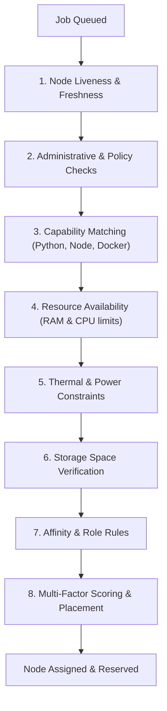

# 04 — Cluster Management Guide: Workloads, Jobs & Scheduling

> **Reading Order**: **Step 4 of 9** in the PersonalServer User Guide sequence.  
> **Previous Guide**: [03 — Deployment Guide](03_deployment.md)  
> **Next Guide**: [05 — High Availability Guide](05_high_availability.md)  
> **Audience**: Cluster administrators and users running asynchronous distributed batch jobs.  
> **Prerequisites**: A running controller and at least one enrolled worker node.

---

## 1. Workload Processing in PersonalServer

In addition to long-running applications (Guide 03), PersonalServer features a powerful distributed job execution engine based on the **Universal Job Contract (J1)** and **Universal Scheduler (J3)**.

### Job Characteristics:
- **Asynchronous Execution**: Submissions return immediately with a unique `job_id`.
- **Resource Reservations**: Workers reserve RAM and CPU shares before job dispatch to prevent Out-Of-Memory (OOM) crashes on smartphones.
- **Process Group Isolation**: Jobs execute in dedicated attempts with strict timeouts, process trees, and stdout/stderr capture.
- **Declared Output Artifacts**: Jobs can declare generated output files, which are hashed (SHA-256), discovered, and collected automatically into cluster storage upon completion.

---

## 2. Submitting Compute Jobs

Jobs are submitted via the Controller CLI or REST API.

### Submitting a Python Batch Job:
```bash
python controller/cli.py jobs submit \
  --code "import sys, platform; print(f'Running on {platform.node()} with Python {sys.version}')" \
  --timeout 60
```
**Output:**
```text
[OK] Job submitted: job-491a-b32c-9801
     Target node: Auto (Universal Scheduler J3)
     Status: PENDING
```

### Submitting a Job with Declared Output Artifacts:
You can instruct a job to produce output files that are preserved in the artifact repository:
```bash
python controller/cli.py jobs submit \
  --code "with open('results.csv', 'w') as f: f.write('timestamp,val\n1,100\n')" \
  --outputs "results.csv" \
  --timeout 120
```

---

## 3. How the Universal Scheduler (J3) Works

When a job is submitted without an explicit `--target-node`, it passes through the **Ordered 8-Stage Eligibility Pipeline**:



### Priority Aging Heuristic:
Jobs that remain queued in the backlog have their effective priority boosted monotonically over time ($P_{eff} = P_{base} + \text{age} \times 0.1$). This guarantees that low-priority batch jobs are never permanently starved by higher-priority tasks.

---

## 4. Monitoring Active & Historical Jobs

### List All Jobs:
```bash
python controller/cli.py jobs list --limit 20
```
**Output:**
```text
+----------------------+----------+--------------------+-----------+----------+
| Job ID               | Status   | Assigned Node      | Duration  | Retries  |
+----------------------+----------+--------------------+-----------+----------+
| job-491a-b32c-9801   | SUCCEEDED| server-realme-5pro | 2.4s      | 0        |
| job-89bc-110a-3211   | RUNNING  | server-realme-5pro | 14.1s     | 0        |
| job-1029-4821-3912   | PENDING  | —                  | —         | 0        |
+----------------------+----------+--------------------+-----------+----------+
```

### Inspecting Job Logs and Stderr:
```bash
python controller/cli.py jobs inspect job-491a-b32c-9801
```
**Output:**
```json
{
  "job_id": "job-491a-b32c-9801",
  "status": "SUCCEEDED",
  "assigned_node": "server-realme-5pro",
  "exit_code": 0,
  "stdout": "Running on server-realme-5pro with Python 3.11.8\n",
  "stderr": "",
  "artifacts": [
    {
      "name": "results.csv",
      "sha256": "e3b0c44298fc1c149afbf4c8996fb92427ae41e4649b934ca495991b7852b855",
      "size_bytes": 22
    }
  ]
}
```

---

## 5. Cancelling Running or Queued Jobs

If a runaway job is consuming excessive compute resources:
```bash
python controller/cli.py jobs cancel job-89bc-110a-3211
```
The controller immediately notifies the assigned worker agent, which sends `SIGTERM` followed by `SIGKILL` to the process group and releases all held RAM reservations.

---

## 6. Next Steps

To ensure that your cluster remains operational even if the master phone battery dies or the process is stopped, configure High Availability:

👉 **Continue to [05 — High Availability Guide](05_high_availability.md)**
