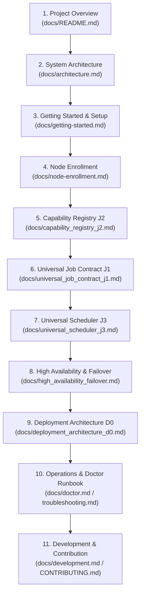

# PersonalServer Documentation System & Canonical Index

> **Project Status**: Production Ready (Milestones J1–J5, R1–R9, HA Cluster Active)  
> **Audience**: Contributors, Operators, System Architects  
> **Last Reviewed**: November 2026  
> **Architecture Target**: Android (Vivo Y31 Controller, Realme 5 Pro Compute Worker) & Linux Edge

Welcome to the canonical documentation tree for **PersonalServer** — an autonomous, self-hosted, distributed edge compute and application hosting platform designed to run 24/7 on recycled Android smartphones (via Termux) and lightweight Linux devices over a secure private mesh (Tailscale) with public ingress (Cloudflare Tunnel).

---

## 🧭 Navigational Reading Sequence

For new contributors and operators, we recommend reading documents in this exact order:

---

## 📚 Complete Document Catalog by Subsystem

### 1. Project Overview & System Architecture
| Document | Status | Intended Audience | Description |
|---|---|---|---|
| [System Architecture](file:///docs/architecture.md) | **Current** | All | System topology, Android-first edge cluster, mesh networking, and ingress planes. |
| [Hardware Migration Plan](file:///docs/hardware_migration_plan.md) | **Historical / Reference** | Architects | Progression from Windows development to dual-Android Termux and Raspberry Pi hardware. |
| [Raspberry Pi Migration](file:///docs/raspberry_pi_migration.md) | **Reference** | Operators | Linux Filesystem Hierarchy Standard (FHS) mapping and systemd integration. |
| [Roadmap & Evolution](file:///docs/roadmap.md) | **Living** | All | Historical milestones (v0.1–v1.2) through modern J1–J5 and R1–R9 implementations. |

### 2. Node Onboarding & Edge Agent
| Document | Status | Intended Audience | Description |
|---|---|---|---|
| [Getting Started](file:///docs/getting-started.md) | **Current** | Beginners / Operators | Initial cluster initialization, environment configuration, and web UI walkthrough. |
| [Node Enrollment](file:///docs/node-enrollment.md) | **Current** | Operators | Zero-touch `PS-XXXX-XXXX` secure pairing protocol, SHA-256 token authentication. |
| [Node Agent & Supervisor](file:///docs/node-agent.md) | **Current** | Operators / Developers | Edge node supervisor, telemetry loop, process tracking, and capability probers. |
| [Reproducible Setup & Backups](file:///docs/reproducible_setup.md) | **Current** | Operators | Clean checkout bootstrapping, backup/recovery automation, and environment safety. |

### 3. Normative Specifications (J1–J3, D0)
> [!IMPORTANT]
> The following documents are **normative architectural specifications**. Their design contracts, error codes, and state machines are authoritative.

| Specification | Status | Normative Scope | Description |
|---|---|---|---|
| [Universal Job Contract (J1)](file:///docs/universal_job_contract_j1.md) | **Frozen / Authoritative** | Core Architecture | Canonical job definition, artifact declarations, environment bindings, and exit contracts. |
| [Capability Registry (J2)](file:///docs/capability_registry_j2.md) | **Frozen / Authoritative** | Core Architecture | Static and dynamic hardware/software capability probing, namespaces, and verification. |
| [Universal Scheduler (J3)](file:///docs/universal_scheduler_j3.md) | **Frozen / Authoritative** | Core Architecture | 8-stage eligibility pipeline, priority aging, multi-factor scoring, atomic reservations. |
| [Deployment Architecture (D0)](file:///docs/deployment_architecture_d0.md) | **Frozen / Authoritative** | Core Architecture | Multi-runtime (Node.js, Python, Static, Docker) deployment engine, lifecycle, and rollback. |

### 4. Workload Scheduling, Execution & Results (J3–J5)
| Document | Status | Intended Audience | Description |
|---|---|---|---|
| [Distributed Scheduler Guide](file:///docs/distributed_scheduler_guide.md) | **Current** | Developers / Operators | Practical guide to workload dispatch, eligibility filtering, and scoring heuristics. |
| [Resource-Aware Scheduling Baseline](file:///docs/scheduling.md) | **Reference** | Developers | Baseline resource constraint matching and Docker requirement enforcement. |
| [Job Lifecycle & Recovery](file:///docs/job_lifecycle_recovery.md) | **Current** | Developers | Finite State Machine (FSM), heartbeat lease sweeping, and worker disappearance recovery. |
| [Job Reliability & Leases](file:///docs/reliability.md) | **Current** | Developers | Monotonic fencing generations, attempt isolation, and CAS state promotion. |
| [Workloads & Allowlist](file:///docs/jobs.md) | **Current** | Developers / Operators | Execution boundaries, allowlisted workload types, and sandbox security. |

### 5. High Availability & Cluster Resilience
| Document | Status | Intended Audience | Description |
|---|---|---|---|
| [High Availability & Failover](file:///docs/high_availability_failover.md) | **Current** | Operators / Architects | Two-node HA leader leases, split-brain defenses, graceful handover, and candidate ranking. |
| [Controller Reference & API](file:///docs/controller.md) | **Current** | Developers / Operators | Authoritative controller endpoints, state stores, CLI management commands. |

### 6. Application Deployment & Multi-Runtime Hosting (R1–R9)
| Document | Status | Intended Audience | Description |
|---|---|---|---|
| [Multi-App Deployment](file:///docs/multi_app_deployment.md) | **Current** | Developers / Operators | Sub-application lifecycle, port assignment, health probing, and automatic rollback. |
| [Image Build & Deploy Workflow](file:///docs/image_build_deploy_workflow.md) | **Current** | Developers | Decoupled image building, container runtime verification, and digest checking. |
| [App Routing & Gateway](file:///docs/domain_migration.md) | **Current** | Operators | Cloudflare ingress, reverse proxy routing, apex domain app forwarding. |

### 7. Storage, Networking & Security
| Document | Status | Intended Audience | Description |
|---|---|---|---|
| [Multi-Node Storage Explorer](file:///docs/storage.md) | **Current** | Developers / Operators | Distributed storage browser, path traversal defenses, and chunked streaming. |
| [Networking & Mesh Ingress](file:///docs/networking.md) | **Current** | Operators | Dual-plane networking: private Tailscale mesh (100.x) and public Cloudflare tunnel. |
| [Security & Threat Model](file:///docs/security.md) | **Current** | Security / Architects | Authentication tokens, privilege separation, environment sanitization, and sandboxing. |

### 8. Operations, Diagnostics & Diagnostics
| Document | Status | Intended Audience | Description |
|---|---|---|---|
| [Doctor Diagnostic Framework](file:///docs/doctor.md) | **Current** | Operators | Self-healing diagnostics (`ps doctor`), automated remediation, and circuit breakers. |
| [Troubleshooting Runbook](file:///docs/troubleshooting.md) | **Current** | Operators | Step-by-step diagnostic procedures for node offline, lease timeouts, and proxy errors. |
| [Multi-Node Simulation Suite](file:///docs/multi_node_simulation.md) | **Current** | QA / Developers | Mock cluster multi-worker loopback test harness for CI/CD and offline verification. |

### 9. Development & Contributing
| Document | Status | Intended Audience | Description |
|---|---|---|---|
| [Development & Testing Guide](file:///docs/development.md) | **Current** | Developers | Setting up virtual environment, test running (`pytest`), coding standards. |
| [Contributor Guidelines](file:///CONTRIBUTING.md) | **Current** | Contributors | Architecture rules, PR hygiene, atomic commit standards, and hardware safety constraints. |

---

## 🔒 Physical Hardware Topology

The operational cluster runs in a dedicated physical topology:

- **Primary Controller / Leader**: Vivo Y31 (Android Termux) — `100.85.108.5:8000`
- **Compute Worker / Standby Controller**: Realme 5 Pro (Android Termux) — `100.73.52.72:8000`
- **Operator Workstation**: Windows 11 PC — for development, test orchestration, and offline simulation.
- **Ingress**: Cloudflare Tunnel routing public domains (`akshatsahay.space`, `server.akshatsahay.space`) directly to the cluster.
