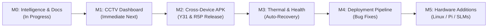

# PersonalServer — Product Roadmap & Milestone Tracking

**Authoritative Roadmap**  
**Last Updated:** November 15, 2026  

---

## Roadmap Overview

---

## Active & Upcoming Milestones

### Milestone M0: Project Intelligence & Documentation Foundation
- **Objective:** Establish a permanent project documentation system, project rules, workflows, and PRD to ensure consistent, autonomous development.
- **Scope:**
  - Repository reconnaissance and technical assessment.
  - Comprehensive requirements interview with the project owner.
  - Authoritative documentation creation (`AGENTS.md`, `.agent/rules/`, `.agent/workflows/`, `docs/`).
  - Architecture Decision Records (`docs/DECISIONS.md`).
  - Requirements Traceability Matrix (`docs/REQUIREMENTS.md`).
- **Dependencies:** None.
- **Status:** **Active / Completing**

---

### Milestone M1: CCTV & Camera Dashboard Integration
- **Objective:** Embed the live 720p 15 FPS Camera2 video stream and controls directly into the central Operations Dashboard (`server.akshatsahay.space` / `:8080`).
- **Scope:**
  - Update `services/node-api/static/index.html` and `app.js` to integrate the live CCTV viewer panel.
  - Camera control widget: Front/Rear camera flip button, resolution selector (720p/480p/360p), snapshot download.
  - Real-time telemetry overlay on stream (battery %, CPU temperature, charging status).
  - Optional listen-in microphone audio toggle.
  - End-to-end integration test validating controller-proxied live viewing from laptop browser.
- **Dependencies:** M0.
- **Status:** **Next Priority**

---

### Milestone M2: Cross-Device APK Stabilization (Android 11 & Android 16)
- **Objective:** Verify and deploy the stabilized Native Bridge APK v1.0.8 across the remaining remote cluster nodes in Gujarat.
- **Scope:**
  - Test APK v1.0.8 on Android 11 physical devices: Vivo Y31 (`server-y31-b842`) and Realme 5 Pro (`server-r5p-c913`).
  - Verify foreground service type permissions and audio/camera lifecycle under Android 11.
  - Validate remote update via git pull and `scripts/update.sh` over Tailscale SSH.
  - Achieve single, unified APK binary compatible across all cluster phones.
- **Dependencies:** M1.
- **Status:** **Scheduled**

---

### Milestone M3: Node Health, Thermal Protection & Auto-Recovery
- **Objective:** Guarantee 24/7 hardware longevity and automated self-healing across mobile nodes.
- **Scope:**
  - Active battery temperature monitor in `Node Agent`: throttle or pause camera streams if battery temp exceeds 42°C.
  - Dashboard thermal alerts and safety notifications.
  - Enhanced node supervisor: automatic detection and resurrection of crashed Node API or worker processes.
- **Dependencies:** M2.
- **Status:** **Scheduled**

---

### Milestone M4: Application Deployment Pipeline Reconfiguration
- **Objective:** Audit, reconfigure, and resolve existing bugs in the multi-runtime application deployment subsystem (`controller/deployment_manager.py`).
- **Scope:**
  - Isolate and fix reported deployment failure bugs.
  - Ensure clean atomic rollbacks when health checks fail.
  - Verify container and native Python application deployment across heterogeneous nodes.
- **Dependencies:** M3.
- **Status:** **Scheduled**

---

### Milestone M5: Future Hardware Expansion & Edge AI
- **Objective:** Onboard Linux laptops, Raspberry Pis, and experiment with local SLM/AI tasks.
- **Scope:**
  - Deploy Universal Bootstrapper on Linux/Pi hardware.
  - Benchmark lightweight local SLM inference (e.g. llama.cpp) on plugged-in nodes.
- **Dependencies:** M4.
- **Status:** **Future Exploration**
