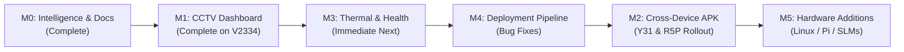

# PersonalServer — Product Roadmap & Milestone Tracking

**Authoritative Roadmap**  
**Last Updated:** November 16, 2026  

---

## Roadmap Overview

---

## Active & Upcoming Milestones

### Milestone M0: Project Intelligence & Documentation Foundation
- **Objective:** Establish a permanent project documentation system, project rules, workflows, and PRD to ensure consistent, autonomous development.
- **Scope:**
  - Repository reconnaissance and technical assessment.
  - Comprehensive requirements interview with the project owner.
  - Authoritative documentation creation (`AGENTS.md`, `.agent/rules/`, `.agent/workflows/`, `docs/`).
  - Architecture Decision Records (`docs/DECISIONS.md`).
  - Requirements Traceability Matrix (`docs/REQUIREMENTS.md`).
- **Dependencies:** None.
- **Status:** **Completed**

---

### Milestone M1: CCTV & Camera Dashboard Integration
- **Objective:** Embed the live 720p/480p Camera2 video stream and controls directly into the central Operations Dashboard (`server.akshatsahay.space` / `:8080`).
- **Scope:**
  - Update `services/node-api/static/index.html` and `app.js` to integrate the live CCTV viewer panel.
  - Camera control widget: Front/Rear camera flip button, resolution selector (720p/480p/360p), snapshot download.
  - Real-time telemetry overlay on stream (battery %, CPU temperature, charging status).
  - Strict on-demand hardware resource allocation: instant auto-release on viewer disconnect or 15s inactivity.
  - Native Bridge companion APK v1.0.9 with battery optimization exemption.
- **Dependencies:** M0.
- **Status:** **Completed & Stabilized on Vivo V2334**

---

### Milestone M3: Node Health, Thermal Protection & Auto-Recovery
- **Objective:** Guarantee 24/7 hardware longevity, thermal safety, and automated self-healing across mobile nodes before expanding to wider cluster devices.
- **Scope:**
  - **Thermal Protection Engine (Completed):** Active battery temperature monitor in `Node Agent` / `node_telemetry.py`: throttle on-demand streams at 42°C, emergency cutoff at 45°C with hysteresis cooldown lock.
  - **Failsafe Remediation Refactor (`doctor.sh fix`):** Ensure autonomous supervisor and watchdog routines explicitly invoke `scripts/doctor.sh fix` (`--repair`) rather than passive diagnostic inspection, actively purging dead PID locks, resurrecting crashed daemons (Node API, Worker, Cloudflared), and repairing state stores.
  - **Zero-Touch Tailscale Auto-Recovery:** Eliminate manual VPN toggling on Android by implementing an automated top-left coordinate tap / Accessibility UI toggle after intent launch (`am start -n com.tailscale.ipn/.MainActivity`) when `100.x.y.z` interface drops.
  - **Dashboard Alerts & Supervisor Resilience:** Real-time thermal alerts on UI, process anti-churn backoff, and Termux service resurrection.
- **Dependencies:** M1.
- **Status:** **Active Priority**

---

### Milestone M4: Application Deployment Pipeline Reconfiguration
- **Objective:** Audit, reconfigure, and resolve existing bugs in the multi-runtime application deployment subsystem (`controller/deployment_manager.py`).
- **Scope:**
  - Isolate and fix reported deployment failure bugs.
  - Ensure clean atomic rollbacks when health checks fail.
  - Verify container and native Python application deployment across heterogeneous nodes.
  - Establish automated deployment regression test suite.
- **Dependencies:** M3.
- **Status:** **Scheduled**

---

### Milestone M2: Cross-Device APK Stabilization & Multi-Node Rollout
- **Objective:** Verify and deploy the stabilized Native Bridge APK across the remaining remote cluster nodes in Gujarat (Vivo Y31 and Realme 5 Pro).
- **Scope:**
  - Deploy unified APK v1.0.9+ on Android 11 physical devices: Vivo Y31 (`server-y31-b842`) and Realme 5 Pro (`server-r5p-c913`).
  - Verify foreground service type permissions and audio/camera lifecycle under Android 11.
  - Validate remote update via git pull and `scripts/update.sh` over Tailscale SSH.
  - Confirm single unified APK binary compatible across all cluster phones.
- **Dependencies:** M4.
- **Status:** **Scheduled (Deferred after M3 & M4)**

---

### Milestone M5: Future Hardware Expansion & Edge AI
- **Objective:** Onboard Linux laptops, Raspberry Pis, and experiment with local SLM/AI tasks.
- **Scope:**
  - Deploy Universal Bootstrapper on Linux/Pi hardware.
  - Benchmark lightweight local SLM inference (e.g. llama.cpp) on plugged-in nodes.
- **Dependencies:** M2.
- **Status:** **Future Exploration**
