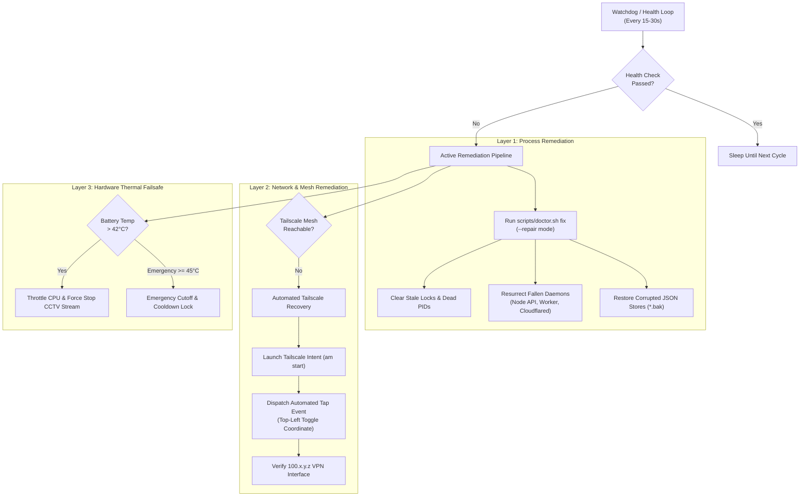

# Feature: Node Failsafe & Autonomous Self-Healing

**Subsystem:** Node Supervisor, Doctor Diagnostic Engine & Network Mesh Failsafe  
**Status:** Authoritative Architectural Specification  
**Current Milestone:** M3 (Node Health & Auto-Recovery)  

---

## 1. Overview & Objectives

PersonalServer operates on unprivileged, heterogeneous hardware—primarily recycled Android smartphones running in Termux without root access. Android operating systems (such as Vivo FuntouchOS and Realme UI) feature aggressive OEM background task killers, thermal throttling, and intermittent WiFi power-saving drops.

The **Failsafe & Autonomous Self-Healing Subsystem** guarantees 24/7 node survivability with **zero manual operator intervention**. When a node encounters a crashed daemon, network disconnection, or corrupted state, the failsafe system automatically diagnoses, remediates, and restores services to healthy operation.

---

## 2. Core Architecture & Supervisory Layers

The failsafe architecture operates in three progressive supervisory layers:



---

## 3. Active Remediation via `scripts/doctor.sh fix`

### 3.1 Passive Inspection vs. Active Remediation
* **The Problem:** The default execution of `scripts/doctor.sh` (or `python scripts/doctor.py`) runs in **passive diagnostic mode**. It inspects processes, sockets, and databases, and prints formatted warnings to stdout, but applies **zero corrective actions**. If the watchdog only runs `scripts/doctor.sh`, degraded services remain degraded.
* **The Architectural Rule:** All autonomous watchdogs, cron jobs, and recovery state machines MUST invoke **`scripts/doctor.sh fix`** (which maps directly to `--repair` in `scripts/doctor.py`).

### 3.2 Automated Repairs Executed by `scripts/doctor.sh fix`:
1. **Dead PID File Cleanup:** Detects orphaned PID files in `runtime/` where the recorded PID is dead or recycled by an unrelated OS process, removing stale lockfiles.
2. **Process Resurrection:**
   - Detects if `services/node-api/app.py` (:8080) crashed; re-launches with output redirected to `logs/node-api.log`.
   - Detects if `agent/node-agent.py work` died; re-launches worker daemon with anti-churn backoff.
   - Detects if `cloudflared` tunnel died; re-launches with token configuration.
3. **Database Integrity Repair:** Detects JSON parse failures in `storage/` or `controller/stores/`; automatically recovers state from the latest validated timestamped backup (`*.bak`).
4. **Port Reclaiming:** Safely terminates lingering zombie sockets holding ports 8000, 8080, or 8088 before spawning replacement instances.

---

## 4. Tailscale Android Automated Reconnection

### 4.1 The Android Tailscale Problem
On Android edge nodes, Tailscale runs as an OS VPN service application (`com.tailscale.ipn`). When cellular/WiFi networks switch, or the OS briefly sleeps the VPN interface:
1. Tailscale enters a disconnected or stalled state.
2. Triggering an Android Intent (`am start -n com.tailscale.ipn/.MainActivity`) only opens the Tailscale application into the foreground.
3. **The VPN toggle switch remains unclicked.** The app sits on screen waiting for physical human touch, breaking remote autonomous operation.

### 4.2 The Solution: Dynamic View Hierarchy Inspection via Android Accessibility Service

Rather than relying on brittle pixel coordinates that break across different screen resolutions and orientations, PersonalServer implements an **unprivileged Android Accessibility Service** (`TailscaleAccessibilityService.java`) embedded directly inside the Native Bridge companion app (`com.personalserver.bridge`).

```mermaid
sequenceDiagram
    participant SUP as Recovery Coordinator / Native Bridge
    participant ANDROID as Android OS / Accessibility Manager
    participant ACC as TailscaleAccessibilityService
    participant TS as Tailscale App (com.tailscale.ipn)
    
    SUP->>SUP: Detect Tailscale VPN offline (no 100.x.y.z IP)
    SUP->>ANDROID: Launch Intent: am start -n com.tailscale.ipn/.MainActivity
    Note over ANDROID,TS: Tailscale UI opens to foreground
    ANDROID->>ACC: onAccessibilityEvent (TYPE_WINDOW_STATE_CHANGED)
    ACC->>TS: Query view hierarchy: "Connect" or com.tailscale.ipn:id/connect_toggle
    ACC->>TS: performAction(AccessibilityNodeInfo.ACTION_CLICK)
    Note over TS: Toggle switch clicked; VPN establishes
    SUP->>SUP: Poll network interface until 100.x.y.z active
    SUP->>ANDROID: Bring PersonalServer Bridge back to foreground
    Note over SUP: Node mesh restored to ONLINE
```

### 4.3 Why Accessibility Inspection is Superior:
1. **100% Screen & Hardware Immune:** Completely immune to screen resolution, DPI, aspect ratio, and portrait/landscape orientation differences across Vivo V2334 (FHD+ 2400x1080), Vivo Y31 (FHD+ 2408x1080), and Realme 5 Pro (FHD+ 2340x1080).
2. **Resilient to UI Theme Shifts:** Finds the node by programmatic view ID (`com.tailscale.ipn:id/connect_toggle`) or localized content description, unaffected by dark mode or accent color shifts.
3. **Scoped Security:** Configured with `packageNames="com.tailscale.ipn"` in its service metadata, ensuring it has zero visibility into any other application on the phone.

#### Option B: Screen-Wake + Model-Calibrated Coordinate Tap (Fallback)
If Accessibility permissions are not granted, the supervisor uses coordinate tapping with essential safety guards:
1. **Screen Wake & Keyguard Dismiss:** Ensure display is turned on and keyguard dismissed before tapping (`input keyevent 26` or Android `wakeUp()` with `FLAG_DISMISS_KEYGUARD`).
2. **Device-Specific Calibration:** Read `node.json` to lookup pre-calibrated coordinates for that specific phone model (e.g. `V2334: (140, 260)`, `R5P: (120, 240)`).
3. **Dispatch Tap:** `input tap <X> <Y>` after a 500ms surface render delay.

---

## 5. Storage, Concurrency & HA Consensus Failsafes

### 5.1 Bounded Log Rotation (Preventing Disk `ENOSPC` Crashes)
To prevent logs from consuming 100% of internal mobile storage over weeks of 24/7 operation:
* All Python entry points (`services/node-api/app.py`, `agent/node-agent.py`) must configure `logging.handlers.RotatingFileHandler`:
  - `maxBytes = 5 * 1024 * 1024` (5 MB per log file).
  - `backupCount = 3` (retaining a maximum of 15 MB total per service).
* Shell startup scripts (`scripts/start.sh`) must pass stdout/stderr through log-truncating pipes or cron cleaners rather than unbounded `>>` appends.

### 5.2 Multi-Process Store Concurrency (`fcntl.flock`)
The Controller JSON stores (`controller/stores/base.py`) must not rely solely on in-process thread locks (`threading.RLock()`). When `doctor.py --repair` or `controller/cli.py` executes in a separate process, they must acquire an OS-level file lock before mutating store files:
```python
import fcntl
with open(lock_file_path, "w") as lock_file:
    fcntl.flock(lock_file.fileno(), fcntl.LOCK_EX)
    try:
        atomic_write_json_file(target_file, data)
    finally:
        fcntl.flock(lock_file.fileno(), fcntl.LOCK_UN)
```
This guarantees zero lost writes or silent database overwrites across concurrent processes.

### 5.3 HA Monotonic Time Consensus (`time.monotonic()`)
Distributed consensus leases in `config/ha_manager.py` must decouple lease expiration from wall-clock `time.time()`. 
* Network latency, clock drift, or automatic NTP updates between geographically distant nodes (Punjab ↔ Gujarat) can step wall-clock time backwards or forwards, triggering false lease expirations and Split-Brain conditions.
* All lease countdowns, election backoffs, and leader heartbeats must compute validity durations using `time.monotonic()`.

---

## 6. Thermal Failsafe (Operational Limits)

Operating mobile phones continuously requires thermal protection to prevent hardware shutdown:
* **`NORMAL` (<= 39.0°C):** Full speed, on-demand 720p 15 FPS video available.
* **`WARM` (39.1°C – 41.9°C):** Warning alert logged, background batch workers throttled.
* **`THROTTLED` (42.0°C – 44.9°C):** On-demand video automatically throttled to 360p @ 5 FPS. Camera lock auto-released after 10s idle.
* **`CRITICAL` (>= 45.0°C):** Immediate emergency hardware cutoff. All active video/audio sessions terminated; Camera2 HAL released. Failsafe enters cooldown lock; rejects new sessions with HTTP 429 until battery temperature drops below 39.0°C.

---

## 7. Traceability & Requirements Mapping

* **FAIL-001:** Autonomous watchdog must invoke `scripts/doctor.sh fix` (`--repair`) to perform active remediation.
* **FAIL-002:** Automated Tailscale toggle via dynamic Accessibility Service (Option A) or calibrated coordinate tap with screen wake (Option B).
* **FAIL-003:** Bounded 5MB log rotation across all daemon logs to prevent `ENOSPC` disk exhaustion.
* **FAIL-004:** Multi-process `fcntl.flock` protection in `controller/stores/base.py` to prevent concurrent write corruption.
* **FAIL-005:** Monotonic clock countdowns in `config/ha_manager.py` to prevent clock-drift split-brain.
* **FAIL-006:** Thermal cutoff and hysteresis cooldown lock for hardware protection.
