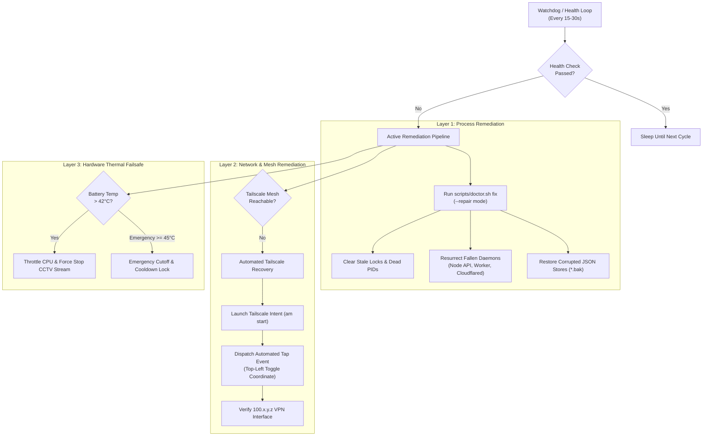
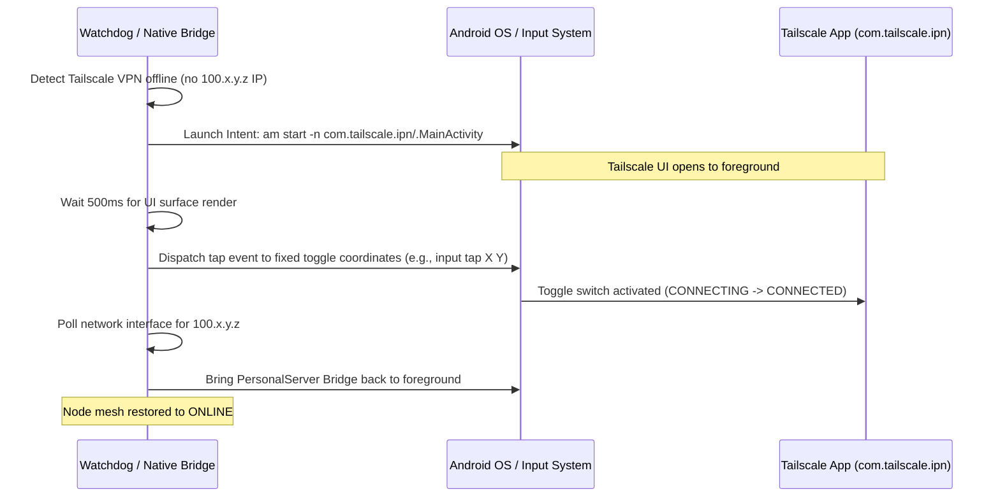

# Feature: Node Failsafe & Autonomous Self-Healing

**Subsystem:** Node Supervisor, Doctor Diagnostic Engine & Network Mesh Failsafe  
**Status:** Authoritative Architectural Specification  
**Current Milestone:** M3 (Node Health & Auto-Recovery)  

---

## 1. Overview & Objectives

PersonalServer operates on unprivileged, heterogeneous hardware—primarily recycled Android smartphones running in Termux without root access. Android operating systems (such as Vivo FuntouchOS and Realme UI) feature aggressive OEM background task killers, thermal throttling, and intermittent WiFi power-saving drops.

The **Failsafe & Autonomous Self-Healing Subsystem** guarantees 24/7 node survivability with **zero manual operator intervention**. When a node encounters a crashed daemon, network disconnection, or corrupted state, the failsafe system automatically diagnoses, remediates, and restores services to healthy operation.

---

## 2. Core Architecture & Supervisory Layers

The failsafe architecture operates in three progressive supervisory layers:

---

## 3. Active Remediation via `scripts/doctor.sh fix`

### 3.1 Passive Inspection vs. Active Remediation
* **The Problem:** The default execution of `scripts/doctor.sh` (or `python scripts/doctor.py`) runs in **passive diagnostic mode**. It inspects processes, sockets, and databases, and prints formatted warnings to stdout, but applies **zero corrective actions**. If the watchdog only runs `scripts/doctor.sh`, degraded services remain degraded.
* **The Architectural Rule:** All autonomous watchdogs, cron jobs, and recovery state machines MUST invoke **`scripts/doctor.sh fix`** (which maps directly to `--repair` in `scripts/doctor.py`).

### 3.2 Automated Repairs Executed by `scripts/doctor.sh fix`:
1. **Dead PID File Cleanup:** Detects orphaned PID files in `runtime/` where the recorded PID is dead or recycled by an unrelated OS process, removing stale lockfiles.
2. **Process Resurrection:**
   - Detects if `services/node-api/app.py` (:8080) crashed; re-launches with output redirected to `logs/node-api.log`.
   - Detects if `agent/node-agent.py work` died; re-launches worker daemon with anti-churn backoff.
   - Detects if `cloudflared` tunnel died; re-launches with token configuration.
3. **Database Integrity Repair:** Detects JSON parse failures in `storage/` or `controller/stores/`; automatically recovers state from the latest validated timestamped backup (`*.bak`).
4. **Port Reclaiming:** Safely terminates lingering zombie sockets holding ports 8000, 8080, or 8088 before spawning replacement instances.

---

## 4. Tailscale Android Automated Reconnection

### 4.1 The Android Tailscale Problem
On Android edge nodes, Tailscale runs as an OS VPN service application (`com.tailscale.ipn`). When cellular/WiFi networks switch, or the OS briefly sleeps the VPN interface:
1. Tailscale enters a disconnected or stalled state.
2. Triggering an Android Intent (`am start -n com.tailscale.ipn/.MainActivity`) only opens the Tailscale application into the foreground.
3. **The VPN toggle switch remains unclicked.** The app sits on screen waiting for physical human touch, breaking remote autonomous operation.

### 4.2 The Solution: Fixed-Coordinate Automated UI Toggle
The Tailscale Android application has a clean, static interface where the main connection toggle button sits at a **fixed, deterministic location in the top-left area** of the screen.

### 4.3 Implementation Strategy:
1. **Coordinate Mapping:** Calibrate standard toggle coordinates per device resolution (e.g. `X=140, Y=260` on 1080x2400 displays) or query the UI node via Android AccessibilityService / Companion Bridge.
2. **Execution Vector:**
   - **Method A (Termux with Accessibility / Input):** `input tap <X> <Y>` executed shortly after launching the intent.
   - **Method B (Native Bridge Service):** Companion app uses an unprivileged Accessibility Service or standard UI automation helper to click the Toggle widget.
3. **Re-Verification Gate:** After toggling, the watchdog verifies that `100.x.y.z` interface responds within 5 seconds before returning PersonalServer to foreground.

---

## 5. Thermal & Hardware Longevity Failsafe

Operating mobile phones continuously requires strict thermal safeguards to prevent battery swelling:
* **`NORMAL` (<= 39.0°C):** Full speed, on-demand 720p 15 FPS video available.
* **`WARM` (39.1°C – 41.9°C):** Warning alert logged, background batch workers throttled.
* **`THROTTLED` (42.0°C – 44.9°C):** On-demand video automatically throttled to 360p @ 5 FPS. Camera lock auto-released after 10s idle.
* **`CRITICAL` (>= 45.0°C):** Immediate emergency hardware cutoff. All active video/audio sessions terminated; Camera2 HAL released. Failsafe enters cooldown lock; rejects new sessions with HTTP 429 until battery temperature drops below 39.0°C.

---

## 6. Traceability & Requirements Mapping

* **FAIL-001:** Autonomous watchdog must invoke `scripts/doctor.sh fix` (`--repair`) to perform active remediation.
* **FAIL-002:** Automated Tailscale toggle via fixed coordinate click / Accessibility automation when VPN drops.
* **FAIL-003:** Thermal cutoff and hysteresis cooldown lock for battery longevity.
* **FAIL-004:** Daemon anti-churn backoff (preventing rapid restart loops if a binary is fundamentally broken).
