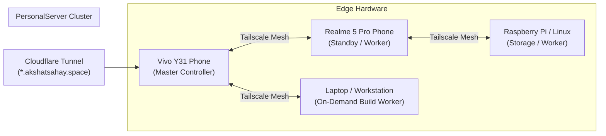

# 01 — Introduction: What is PersonalServer?

> **Reading Order**: **Step 1 of 12** in the PersonalServer Guide Series.  
> **Next Guide**: [02 — Hardware & System Requirements](02_requirements.md)  
> **Audience**: Beginners, operators, and developers exploring PersonalServer.  
> **Prerequisites**: None.

---

## 1. Executive Overview

**PersonalServer** is an autonomous, self-hosted, distributed compute cluster and edge application platform designed to run 24/7 on heterogeneous, recycled personal hardware. Instead of paying for expensive cloud VMs or letting old smartphones and computers collect dust, PersonalServer turns idle Android smartphones, single-board computers (Raspberry Pis), old laptops, and Linux workstations into a unified, resilient personal cloud.

PersonalServer unites these asymmetric devices into an active compute cluster capable of hosting long-running web applications (Python, Node.js, static sites) and running distributed asynchronous batch jobs.

---

## 2. Core Architectural Principles

1. **Zero Heavy Infrastructure**: The core controller, agent, consensus engine, and storage subsystems run exclusively on the **Python 3.9+ standard library**. No external SQL databases, Redis, Celery, or heavy container daemons are required for cluster operation.
2. **Android-First Edge Compute**: Unrooted smartphones running Termux serve as 24/7 always-on controllers and workers. Phones have built-in battery backups (UPS), low power consumption (<3W idle), and cellular failover capabilities.
3. **Consensus-Driven High Availability**: Built-in leader lease consensus ensures that if the master phone powers off or loses connectivity, a standby node automatically assumes leadership without dropping cluster state.
4. **Universal Multi-Runtime Hosting**: Deploy web applications in native Python (venv), Node.js (npm), or static HTML/SPA with health monitoring, automatic port allocation, and instant rollback.
5. **Private Mesh Networking**: Inter-node RPCs, heartbeats, and data exchange operate over an encrypted Tailscale WireGuard mesh, protecting private endpoints from public internet exposure.

---

## 3. Who is PersonalServer For?

- **Self-Hosters & Homelabbers**: Run web applications, APIs, Discord bots, and scheduled scripts without paying monthly VPS bills.
- **Developers**: Test distributed algorithms, consensus mechanisms, and worker scheduling on real heterogeneous hardware.
- **Edge Computing Enthusiasts**: Experiment with mobile edge compute, thermal-aware scheduling, and battery-friendly background task execution.

---

## 4. Documentation Roadmaps

Depending on your goal, follow one of two curated journeys:

### The Beginner / Operator Journey (Guides 01–09)
Follow guides 01 through 09 in numerical order to set up your hardware, configure private networking, install the controller, enroll worker devices, deploy your first web app, and configure High Availability.

### The Engineer / Contributor Journey (Guides 10–12)
Jump to [10 — Development](10_development.md) to explore the codebase, run test suites offline, understand the normative specifications in [11 — Architecture](11_architecture.md), and implement custom runtime adapters.

---

## 5. Next Step

Learn about supported hardware, operating systems, and minimum resource requirements:

👉 **Continue to [02 — Hardware & System Requirements](02_requirements.md)**
