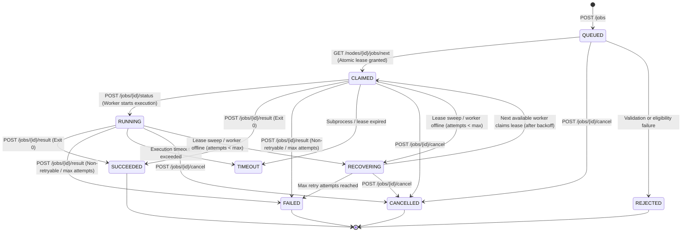

# PersonalServer — Reliable Job Lifecycle and Crash Recovery Guide

## 1. Overview & Execution Semantics

PersonalServer implements a **lease-based, resource-aware job scheduling and execution engine**.

### Execution Semantics: At-Least-Once
Because network partitions, process crashes, and power failures can prevent a worker from communicating its execution result back to the controller, PersonalServer provides **at-least-once execution** for retryable workloads.
- **Idempotency**: Workloads should be designed to be idempotent where feasible.
- **Non-Retryable Workloads**: For non-idempotent workloads (e.g. state-mutating actions or non-reentrant external calls), clients can explicitly set `"retryable": false` or `"max_attempts": 1`. When a worker holding a non-retryable job crashes or disappears, the job transitions directly to terminal `FAILED` (`retry_reason: "Non-retryable failure"`) and will not be re-executed.

---

## 2. Job State Transition Model

PersonalServer tracks jobs through a deterministic finite state machine (FSM).



### Valid State Transitions Table

| Current State | Allowed Next States | Description |
|---|---|---|
| `QUEUED` | `CLAIMED`, `CANCELLED`, `REJECTED` | Initial submission awaiting worker claim or client cancellation. |
| `CLAIMED` | `RUNNING`, `SUCCEEDED`, `FAILED`, `TIMEOUT`, `CANCELLED`, `RECOVERING` | Leased to worker; worker may acknowledge execution or report final status. |
| `RUNNING` | `SUCCEEDED`, `FAILED`, `TIMEOUT`, `CANCELLED`, `RECOVERING` | Active execution on assigned worker. |
| `RECOVERING` | `CLAIMED`, `FAILED`, `CANCELLED` | Intermediate retry state; awaiting exponential backoff before being re-claimed. |
| `SUCCEEDED` | *(Terminal)* | Execution finished with exit code 0. Duplicate reports return idempotent HTTP 200. |
| `FAILED` | *(Terminal)* | Execution finished with non-zero exit code or retry attempts exhausted. |
| `TIMEOUT` | `RECOVERING` or `FAILED` | Execution exceeded timeout threshold. |
| `CANCELLED` | *(Terminal)* | Explicitly cancelled by operator or API client. Cannot be claimed or retried. |
| `REJECTED` | *(Terminal)* | Job payload invalid, unsafe command, or target node offline. |

---

## 3. Reliability & Recovery Mechanisms

### 1. Atomic Leases and Crash Detection
When a worker polls `/nodes/<node_id>/jobs/next`:
- The controller atomically assigns the job, transitions it to `CLAIMED`, and computes `lease_expires_at = now + timeout + DEFAULT_LEASE_GRACE_SEC`.
- If the worker crashes, loses power, or disconnects without reporting back, the controller background lease sweeper (`sweep_expired_leases`) identifies that `now > lease_expires_at` or `node_liveness == OFFLINE`.
- The lease is revoked, and the job transitions to `RECOVERING` or `FAILED`. It is **never** silently marked successful.

### 2. Exponential Backoff & Retry Loops
To prevent immediate retry stampedes against a struggling worker:
- Every recovery transition computes an exponential backoff:
  $$\text{backoff\_sec} = \min(60.0, \text{base\_backoff} \times 2^{(\text{attempt} - 1)})$$
- The controller sets `retry_after = now + backoff_sec`.
- Workers polling `/jobs/next` cannot claim a `RECOVERING` job until `now >= retry_after`.

### 3. Stale Worker & Split-Brain Protection
If Worker A experiences a network delay, its lease expires, and the controller recovers the job to Attempt 2 on Worker B:
- If Worker A subsequently attempts to report the result of Attempt 1, the controller compares `body.attempt` with `job.attempt`.
- Because `1 < 2`, the controller rejects the stale report with **HTTP 409 Conflict** (`stale_attempt: true`).
- Worker A cannot overwrite Worker B's state or corrupt the job history.

### 4. Idempotent Duplicate Completion
If network retries replay an identical completion message for a job that is already in terminal state `SUCCEEDED` or `CANCELLED`:
- The controller returns **HTTP 200** with `duplicate: true`.
- The job's terminal status, completion timestamp, and single attempt history remain untampered.

### 5. Self-Healing Persistence
- Every write to `jobs.json` is staged via `.tmp` file, followed by a copy to `jobs.json.bak`, followed by atomic replacement.
- If `jobs.json` becomes corrupted (e.g. sudden power loss during write), `load_jobs_db()` detects the corruption, automatically recovers all records from `jobs.json.bak`, and self-heals `jobs.json` on disk.

### 6. Bounded Logs & Sensitive Data Redaction
- Worker `stdout` and `stderr` payloads are capped to 64 KB (65,536 characters) before persistence to protect database memory and disk limits.
- Sensitive keys (`token`, `password`, `secret`, `key`, `authorization`, `cookie`) are automatically masked using `redact_sensitive_dict`.

---

## 4. Operational Recovery Guide

### Diagnosing Interrupted Jobs
To inspect all recovering or claimed jobs:
```powershell
curl -s http://127.0.0.1:8000/jobs?status=RECOVERING
curl -s http://127.0.0.1:8000/jobs?status=CLAIMED
```

### Forcing a Manual Lease Sweep
The controller automatically sweeps leases every 3 seconds, but an operator can trigger an immediate evaluation by querying cluster utilization or the jobs endpoint:
```powershell
curl -s http://127.0.0.1:8000/cluster/utilization
```

### Cancelling a Stuck Job
If a job is queued or held on a problematic node:
```powershell
curl -X POST http://127.0.0.1:8000/jobs/<job_id>/cancel -H "Authorization: Bearer <enrollment_token>" -H "Content-Type: application/json" -d "{\"reason\": \"Operator manual cancellation\"}"
```

### Recovering After Controller Reboot
When the controller is restarted:
1. `start_server()` loads `jobs.json` (falling back to `jobs.json.bak` if needed).
2. It immediately executes `sweep_expired_leases(jobs_db, nodes_db, timeout)`.
3. Interrupted jobs whose workers are no longer active transition to `RECOVERING`.
4. Online workers automatically resume claiming work via `/nodes/<id>/jobs/next`.
