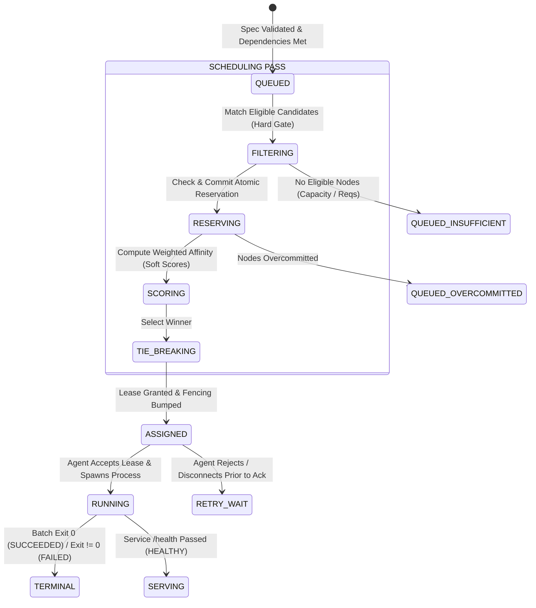
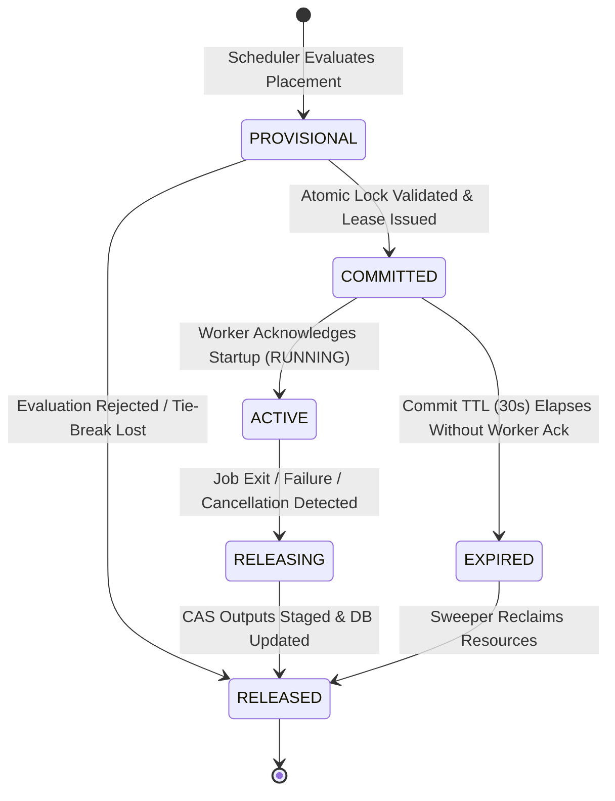

# PersonalServer Universal Scheduler (US) v1.0
## Milestone J3.1, J3.2 & J3.3 Architectural Specification

**Status:** Proposed Architecture  
**Author:** Antigravity Engineering  
**Version:** us.v1.0  
**Phase:** PersonalServer Phase 2 — Universal Job Execution, Milestones J3.1, J3.2 & J3.3  

---

## 1. Architecture Overview & Component Boundaries

### 1.1 Mission & Vision
Milestones J1 (Universal Job Contract `ujc.v1.0`) and J2 (Capability Registry `cr.v1.0`) decoupled job requirements and node hardware declarations from specific language runtimes. 

Milestones J3.1, J3.2, and J3.3 design the **Universal Scheduler**, **Node Eligibility Engine**, and **Resource Allocation & Reservation Model** for PersonalServer: a deterministic, capability-aware, availability-conscious, and resource-bounded placement engine. It schedules both terminating batch tasks and supervised services across heterogeneous nodes without relying on heavy external cluster managers (Kubernetes/Nomad) or external cloud infrastructure.

### 1.2 Core Operating Environment & Physical Reality
1. **Vivo Y31 (Android 11, Termux, aarch64, 8 cores, ~5.7 GB RAM, 106 GB storage):** Primary control plane, ingress, Application Router, and scheduler host.
2. **Realme 5 Pro (Android 11, Termux, aarch64, 8 cores, ~5.6 GB RAM, 50 GB storage, udocker):** Primary compute worker.
3. **Windows 11 Laptop (x86_64, 12 cores, 24 GB RAM, RTX 3050 6 GB GPU, Docker Engine):** Optional, opportunistic compute worker.
   - *Strict Invariant:* The Windows laptop is **never a mandatory production dependency**. The Vivo Y31 and Realme 5 Pro must independently sustain 100% of production workloads indefinitely while the laptop is offline.

### 1.3 Component Boundaries

```
┌────────────────────────────────────────────────────────────────────────────────┐
│ CONTROLLER / CONTROL PLANE (Vivo Y31)                                          │
│                                                                                │
│  ┌──────────────────────┐       ┌───────────────────────────────────────────┐  │
│  │ Job Ingress & API    │       │ Capability Registry (CR v1.0)             │  │
│  │ (ujc.v1.0 Validator) │       │ - Static Hardware & Verified Runtimes     │  │
│  └──────────┬───────────┘       │ - Ephemeral Telemetry (15s heartbeat)     │  │
│             │                   └─────────────────────┬─────────────────────┘  │
│             ▼                                         │                        │
│  ┌────────────────────────────────────────────────────▼─────────────────────┐  │
│  │ UNIVERSAL SCHEDULER (US v1.0)                                            │  │
│  │                                                                          │  │
│  │   [Phase 1] Hard Eligibility Gate  ──▶ Rejects Ineligible (Audit Logged) │  │
│  │   [Phase 2] Atomic Reservation     ──▶ Authoritative In-Flight Ledger    │  │
│  │   [Phase 3] Multi-Factor Scoring   ──▶ Transparent Fit & Mobile Penalty  │  │
│  │   [Phase 4] Deterministic Tie-Break──▶ Highest Score / Stable Lexical    │  │
│  │   [Phase 5] Lease Grant & Fencing  ──▶ Increments Monotonic Token        │  │
│  └──────────────────────┬───────────────────────────────────────────────────┘  │
│                         │                                                      │
│  ┌──────────────────────▼─────────────────────┐ ┌───────────────────────────┐  │
│  │ Lease Sweeper & Reconciliation             │ │ Application Router        │  │
│  │ - Expired Lease Reclaims & Backoff Delay   │ │ - Service Target Upstream │  │
│  │ - Expired Dynamic Reservation Purging      │ │   (Fencing Token Guarded) │  │
│  └────────────────────────────────────────────┘ └───────────────────────────┘  │
└─────────────────────────┬──────────────────────────────────────────────────────┘
                          │ (Dispatched Lease via HTTP / Polled Queue)
                          ▼
┌────────────────────────────────────────────────────────────────────────────────┐
│ COMPUTE WORKER (Realme 5 Pro / Optional Windows Laptop)                         │
│                                                                                │
│  ┌──────────────────────────────────────────────────────────────────────────┐  │
│  │ Node Agent (JobExecutor)                                                 │  │
│  │ - Validates Fencing Token & Lease Signature                              │  │
│  │ - Creates Attempt-Namespaced Sandbox (.../attempts/<attempt>/)           │  │
│  │ - Executes Runtime Adapter (Python / Node / Static / Container)          │  │
│  │ - Emits Heartbeat Telemetry & Reports Exit State                         │  │
│  └──────────────────────────────────────────────────────────────────────────┘  │
└────────────────────────────────────────────────────────────────────────────────┘
```

---

## 2. Scheduling Lifecycle and State Transitions

The Universal Scheduler governs the transition from a validated, dependency-free specification (`QUEUED`) to worker lease acceptance (`RUNNING`).



### 2.1 Scheduling Lifecycle Steps
1. **Ingress & Dependency Evaluation (`SUBMITTED` $\to$ `VALIDATED` $\to$ `QUEUED`):**
   - The job is checked for canonical RFC 8785 serialization and root `spec_hash`.
   - Upstream DAG dependencies (`spec.dependencies[]`) must all be in `SUCCEEDED` status. If any upstream job is pending, the job enters `WAITING_FOR_DEPENDENCY`.
2. **Hard Eligibility Filtering (Phase 1):**
   - Every registered cluster node is evaluated against hard operational invariants.
   - Ineligible nodes are rejected with explicit, auditable failure reasons.
3. **Resource Reservation Check (Phase 2):**
   - Active reservations from concurrent in-flight jobs on each candidate are deducted from live available capacity.
   - If a candidate cannot satisfy the unreserved memory, storage, or core floor, it is disqualified.
4. **Soft Scoring & Optimization (Phase 3):**
   - Surviving candidates are evaluated against multi-factor scoring (0.0 to 100.0) based on memory headroom, thermal safety, battery charging status, network latency, and node affinity hints.
5. **Deterministic Selection & Tie-Breaking (Phase 4):**
   - Candidate with the highest score wins. Ties are broken deterministically using availability class hierarchy followed by lexical node identifier.
6. **Lease Grant & Atomic Handshake (Phase 5 $\to$ `ASSIGNED`):**
   - The Controller increments the job's monotonic `fencing_token`.
   - An execution lease is generated binding `(job_id, attempt, lease_token, fencing_token, expires_at)`.
   - A short-lived reservation lock is recorded in the controller's authoritative ledger.
7. **Execution Handoff (`ASSIGNED` $\to$ `RUNNING`):**
   - The worker agent accepts the lease, verifies the fencing token, provisions attempt-namespaced sandbox directories, and spawns the runtime process.
   - When the agent acknowledges process startup via `POST /api/v1/jobs/{id}/heartbeat`, the job formally enters `RUNNING`.

---

## 3. Hard Eligibility Constraints (Phase 1 Gate)

A node MUST satisfy 100% of the following hard constraints to be considered eligible. If any single constraint fails, the node is immediately rejected before scoring:

### 3.1 Node Liveness & Reachability Gate
1. **Liveness State:** `compute_node_liveness(node) == STATE_ONLINE`. Nodes in `OFFLINE`, `UNHEALTHY`, `DRAINING`, `DEBOARDING`, or `REMOVED` are rejected.
2. **Heartbeat Freshness:** `now - node.last_seen <= 60` seconds (`DEFAULT_HEARTBEAT_TIMEOUT`).
3. **Offline Invariant:** An offline node (including the Windows laptop) is **unconditionally disqualified**, regardless of historical capabilities, total VRAM, or preferred node hints.

### 3.2 Capability & Architecture Gate
4. **Architecture Match:** The node's normalized architecture (`cr.v1.0` `compute.architecture`) must match `job.spec.requirements.architecture` (unless `"any"` is declared).
5. **Capability Requirements:** Every capability listed in `job.spec.requirements.capabilities` must exist in the node's capability registry.
6. **Verification Requirement:**
   - If `job.spec.requirements.verified_capabilities` is declared OR `require_verified: true`, every requested capability must be present in `node.verified_capabilities` with `verified: true`.
   - Stale verifications (`metadata.is_stale_verification == true`) disqualify the node for verified-mandatory jobs.
7. **Docker vs. udocker Isolation:**
   - If a job requests `container_runtime:docker` or runtime `container/docker`, the node must have a verified Docker Engine daemon.
   - **`udocker` strictly never satisfies a `docker` requirement.**

### 3.3 Resource Capacity Gate (Floors)
8. **CPU Cores:** `node.capabilities.compute.cpu_cores >= job.spec.requirements.resources.min_cpu_cores`.
9. **Physical RAM Floor:** `node.capabilities.compute.ram_total_mb >= job.spec.requirements.resources.min_memory_mb`.
10. **Storage Capacity Floor:** `node.capabilities.storage.total_gb >= (job.spec.requirements.resources.min_storage_mb / 1024)`.

### 3.4 Availability Class & Mobile Gates
11. **Availability Class Compatibility:** The node's availability class must satisfy the workload's required availability class (e.g. A long-running `service` cannot be scheduled on an `Opportunistic` worker).
12. **Battery Threshold:** If `job.spec.requirements.hints.allow_on_battery == false`, mobile nodes on battery power (`mobile_state.power_source == "BATTERY"`) are rejected.
13. **Minimum Battery Floor:** If on battery, `node.telemetry.mobile_state.battery_percentage >= job.spec.requirements.hints.min_battery_percent`.
14. **Thermal Throttling Protection:** Nodes with `mobile_state.thermal_state == "Critical"` are rejected from all new job assignments.

### 3.5 Administrative & Policy Restrictions Gate
15. **Node Drain / Cordon:** Nodes marked `STATE_DRAINING` reject all new placements.
16. **Active Policy Overrides:** If `node.policy_overrides.disabled_capabilities` contains any capability required by the job, the node is rejected until the override expires.
17. **Node Anti-Affinity:** If `node.labels` match any pattern in `job.spec.requirements.hints.node_anti_affinity`, the node is rejected.

---

## 4. Multi-Factor Soft Scoring Model (Phase 3)

Eligible nodes that pass the Hard Eligibility Gate are scored on a scale from **0.0 to 100.0 points**.

### 4.1 Scoring Normalization & Concurrency Penalty Resolution (J3.1 Correction)
In Milestone J3.1, the base positive dimensions summed to 100 points, while concurrency subtracted up to 20 points, creating a potential raw score range of $[-20, 100]$.

To resolve this ambiguity and ensure clean mathematical bounds:
1. **Raw Score Calculation:**
   $$\text{Raw Score} = S_{\text{memory}} + S_{\text{cpu}} + S_{\text{storage}} + S_{\text{mobile}} + S_{\text{network}} + S_{\text{class}} + S_{\text{preferred}} - P_{\text{concurrency}}$$
2. **Normalization and Clamping:**
   $$\text{Final Score} = \min(100.0, \max(0.0, \text{Raw Score}))$$
3. **Hard Constraint Independence:** A high soft score **never** overrides a failed hard eligibility constraint. Only nodes that pass 100% of hard constraints are evaluated by the scoring function.

```
Scoring Dimension Breakdown:
┌─────────────────────────────────┬────────────┬──────────────────────────────────────────┐
│ Dimension                       │ Max Points │ Weight / Formula                         │
├─────────────────────────────────┼────────────┼──────────────────────────────────────────┤
│ 1. Available Unreserved Memory  │ 30.0 pts   │ (effective_avail_mb / total_mb) * 30.0   │
│ 2. CPU Headroom & Load          │ 25.0 pts   │ max(0, (1.0 - load_1m / cores)) * 25.0   │
│ 3. Storage Headroom             │ 10.0 pts   │ (effective_avail_gb / total_gb) * 10.0   │
│ 4. Mobile & Thermal Health      │ 15.0 pts   │ AC Power bonus + Thermal margin          │
│ 5. Network Latency Quality      │ 10.0 pts   │ max(0, 10.0 - (ping_ms / 10.0))          │
│ 6. Availability Class Fit       │ 10.0 pts   │ Class affinity matching bonus            │
│ 7. Preferred Node Bonus         │ +15.0 pts  │ Explicit node target bonus               │
│ 8. Concurrency Penalty          │ -20.0 pts  │ -5.0 pts per active running job          │
└─────────────────────────────────┴────────────┴──────────────────────────────────────────┘
```

### 4.2 Thermal State Classification Alignment (J3.1 Correction)
Milestone J3.1 referenced a proposed numeric `<38°C` threshold. In accordance with J2 Capability Registry (`cr.v1.0`), the scheduler adheres strictly to the node-reported qualitative thermal taxonomy:
- **`Cool`**: Full thermal margin ($+7.0\text{ pts}$).
- **`Normal`**: Standard operating margin ($+4.0\text{ pts}$).
- **`Warm`**: Heavy thermal load, approaching throttle ($0.0\text{ pts}$).
- **`Critical`**: Disqualified in Hard Gate (rejection code: `THERMAL_THROTTLING_CRITICAL`).

---

## 5. Node Availability Classes

PersonalServer nodes are classified by operational availability and hardware volatility:

| Availability Class | Representative Hardware | Characteristics | Allowed Workload Classifications |
| :--- | :--- | :--- | :--- |
| **`Always-on`** | Vivo Y31 (AC Connected) | Controller plane, battery buffered on continuous mains power. 99.9% uptime. | `service`, `batch`, `step` |
| **`Persistent`** | Realme 5 Pro (Dedicated Worker) | Compute worker, continuous Wi-Fi, managed charging envelope. | `service`, `batch`, `step` |
| **`Opportunistic`** | Windows 11 Laptop | Intermittent uptime, gaming/workload priority, lid close/sleep cycles. | `batch` only (Preemptible) |
| **`On-demand`** | Ephemeral worker / hotspot | Mobile hotspot connection, transient compute bursts. | `batch` only (High priority) |

---

## 6. Fencing Token & Lease Integration

The scheduler enforces J1's authoritative fencing contract:
1. **Monotonic Progression:** The controller increments `status.lease.fencing_token` on every assignment or retry transition.
2. **Lease TTL:** Assigned leases are granted for **45 seconds** and must be renewed by worker heartbeats every 15 seconds.
3. **Stale Completion Rejection:** Any worker status update, artifact upload, or router activation carrying a fencing token lower than the controller's authoritative current token is rejected with `412 Precondition Failed`.

---

## 7. Milestone J3.2: Node Eligibility Engine Specification

### 7.1 Ordered Eligibility Evaluation Pipeline
The engine executes checks in a strict, short-circuiting sequence:
1. **Stage 1 (Liveness & Freshness Gate):** `compute_node_liveness == ONLINE` and `heartbeat_age <= 60s`. If offline, evaluation stops immediately.
2. **Stage 2 (Administrative & Policy Gate):** Checks `DRAINING`/`DEBOARDING`, active policy overrides, and anti-affinity rules.
3. **Stage 3 (Availability Class Gate):** Matches workload duration against node availability (`Always-on`, `Persistent`, `Opportunistic`).
4. **Stage 4 (Runtime & Architecture Compatibility Gate):** Validates normalized architecture and runtimes; strictly rejects `udocker` for Docker Engine requirements.
5. **Stage 5 (Hardware Peripheral State Gate):** Verifies required devices are in `ACCESSIBLE` status (rejects `DETECTED`, `UNAVAILABLE`, `UNKNOWN`, or active lease locks).
6. **Stage 6 (Capability Verification Freshness Gate):** Ensures verification TTL is unexpired (`is_stale_verification == false`).
7. **Stage 7 (Mobile Battery & Thermal Gate):** Enforces AC requirements, battery floors, and rejects `Critical` thermal states.
8. **Stage 8 (Resource Headroom Gate Post-Reservation):** Validates unreserved memory, storage, and CPU floors after deducting active in-flight commitments.

### 7.2 Rejection Taxonomy & Error Classification

| Reason Code | Category | Rejection Meaning | Scheduler Action |
| :--- | :--- | :--- | :--- |
| `NODE_OFFLINE` | Transient | Node heartbeat missing ($>60\text{s}$) or host disconnected. | Re-evaluate on node heartbeat reconnection. Job stays `QUEUED`. |
| `NODE_DRAINING` | Transient | Node is cordoned by operator for maintenance. | Re-evaluate when node restored or alternative online. Job stays `QUEUED`. |
| `INSUFFICIENT_UNRESERVED_RAM` | Transient | Candidate lacks free RAM after deducting in-flight reservations. | Re-evaluate on job completion or lease reclaim. Job stays `QUEUED`. |
| `INSUFFICIENT_UNRESERVED_STORAGE` | Transient | Candidate lacks free storage after deducting in-flight reservations. | Re-evaluate on job completion or artifact purge. Job stays `QUEUED`. |
| `BATTERY_POWER_DISALLOWED` | Transient | Mobile node running on battery; job requires AC power. | Re-evaluate when charger plugged in (`PLUGGED_AC`). Job stays `QUEUED`. |
| `BATTERY_LEVEL_BELOW_MINIMUM` | Transient | Battery % is below job floor (e.g. $18\% < 25\%$). | Re-evaluate when battery charges above floor. Job stays `QUEUED`. |
| `THERMAL_THROTTLING_CRITICAL` | Transient | Node in critical thermal throttle. | Re-evaluate when thermal status returns to `Normal`/`Cool`. Job stays `QUEUED`. |
| `CAPABILITY_VERIFICATION_STALE` | Transient | Node capability verification TTL expired. | Re-evaluate after worker executes smoke re-probe. Job stays `QUEUED`. |
| `HARDWARE_LEASE_CONFLICT` | Transient | Peripheral (e.g. Camera) locked by another active job. | Re-evaluate when holding job terminates lease. Job stays `QUEUED`. |
| `UNSATISFIABLE_CAPABILITY` | **Permanent** | Requested capability does not exist on **any** node in cluster. | Transition job immediately to `FAILED` / `REJECTED`. |
| `UNSUPPORTED_ARCHITECTURE` | **Permanent** | Architecture (e.g. `x86_64`) unsupported by any registered node. | Transition job immediately to `FAILED` / `REJECTED`. |
| `DOCKER_ENGINE_NOT_AVAILABLE` | **Permanent/Transient** | Job requires Docker; cluster only possesses `udocker` or Android nodes. | Permanent if no Docker host enrolled; Transient if laptop offline. |
| `HARDWARE_PERIPHERAL_UNPERMITTED`| **Permanent** | Hardware is `DETECTED` but OS permission not granted to agent. | Transition job to `FAILED` (`HARDWARE_ACCESS_DENIED`). |

---

## 8. Milestone J3.3: Resource Allocation and Reservation Model

Milestone J3.3 specifies the concurrency-safe resource reservation engine, multi-resource accounting model, authoritative ledger consistency, reservation lifecycle, and preemption policies.

### 8.1 Multi-Resource Accounting Model
Telemetry reflects past state (delayed by up to 15 seconds) and **cannot guarantee reservation capacity**. The scheduler defines a multi-resource capacity equation that accounts for safety buffers and active allocations:

```
Total Physical Capacity (Static Hardware Fact)
├── OS & System Baseline Reservation (Kernel, Android Framework, Daemons)
├── Safety Headroom Buffer (Memory Pressure & Thermal Protection)
├── Unreserved Allocatable Capacity (Available to Scheduler)
│   ├── Active In-Flight Reservations (Ledger Committed)
│   └── Allocatable Headroom for Next Job Candidate
```

#### Capacity Definitions:
1. **$C_{\text{physical}}$ (Physical Capacity):** Immutable hardware total declared in `cr.v1.0` (`compute.ram_total_mb`, `compute.cpu_cores`, `storage.total_gb`).
2. **$C_{\text{observed}}$ (Observed Available Capacity):** Dynamic available capacity reported by the latest valid node heartbeat (`telemetry.memory.available_mb`, `telemetry.storage.available_gb`).
3. **$C_{\text{headroom}}$ (Safety Headroom Floor):** Non-allocatable buffer reserved for operating system stability, preventing Termux low-memory killer (LMK) invocations:
   - *Android Nodes (Vivo Y31, Realme 5 Pro):* $\max(300\text{ MB}, 0.10 \times C_{\text{physical}})$.
   - *Windows Worker:* $\max(1024\text{ MB}, 0.05 \times C_{\text{physical}})$.
4. **$R_{\text{active}}$ (Reserved Ledger Capacity):** Sum of committed resource demands for all in-flight jobs on node $N$:
   $$R_{\text{active}}(N) = \sum_{j \in \text{in\_flight}(N)} j.\text{min\_memory\_mb}$$
5. **$C_{\text{allocatable}}$ (Effective Headroom for Placement):**
   $$C_{\text{allocatable}}(N) = \max\left(0, \min(C_{\text{observed}}, C_{\text{physical}} - C_{\text{headroom}}) - R_{\text{active}}(N)\right)$$

*Core Accounting Invariant:* A new job requesting $M$ megabytes is accepted on node $N$ if and only if $M \le C_{\text{allocatable}}(N)$.

---

### 8.2 Authoritative Reservation Ledger and Atomic Reservation Protocol
To prevent two concurrent scheduling loops from committing the same remaining RAM to separate jobs, PersonalServer uses an **Authoritative In-Memory Reservation Ledger** on the controller guarded by a thread-safe atomic lock (`threading.Lock` / single-writer transactional mutation).

#### Ledger Schema (`controller.reservation_ledger`):
```json
{
  "res-job-ujc-8812-att1": {
    "reservation_id": "res-job-ujc-8812-att1",
    "job_id": "job-ujc-py-data-8812",
    "attempt": 1,
    "node_id": "server-95bad5ff01424d4c8d184330d6d2e394",
    "fencing_token": 2,
    "state": "COMMITTED",
    "created_at": "2026-11-06T00:05:00.000000Z",
    "commit_expires_at": "2026-11-06T00:05:30.000000Z",
    "resources": {
      "memory_mb": 256,
      "storage_mb": 512,
      "cpu_cores": 1,
      "exclusive_devices": []
    }
  }
}
```

#### Atomic Reservation Protocol:
```
[Scheduler Pass]               [Atomic Reservation Ledger]         [Jobs DB / Node DB]
       |                                    |                                |
       |--- 1. Acquire Mutex Lock --------->|                                |
       |                                    |                                |
       |--- 2. Query Active Ledger Math --->|                                |
       |       Calculate C_allocatable(N)   |                                |
       |                                    |                                |
       |--- 3. Validate C_allocatable >= M -|                                |
       |       (If insufficient, REJECT)    |                                |
       |                                    |                                |
       |=== 4. ATOMIC COMMIT ===============|                                |
       |    - State: COMMITTED              |                                |
       |    - Set commit_expires_at = +30s  |                                |
       |    - Bump fencing_token = token + 1|                                |
       |                                    |--- 5. Commit Job to ASSIGNED ->|
       |                                    |       Write Fencing Token      |
       |                                    |                                |
       |<-- 6. Release Mutex Lock ----------|                                |
```

- **Idempotency Guarantee:** If a scheduling pass evaluates a job that already holds a valid reservation for the current `(job_id, attempt, fencing_token)`, the operation returns the existing reservation without double-counting.
- **Race Condition Immunity:** If two scheduling attempts simultaneously target the final 200MB of RAM, the first worker acquires the lock, claims the capacity, and reduces $C_{\text{allocatable}}$ below 200MB. The second worker immediately fails step 3 and rejects placement on that candidate.

---

### 8.3 Reservation Lifecycle State Machine

A reservation progresses through six distinct lifecycle phases:



| Lifecycle State | Description | Consumes Capacity? | Timeout & Sweep Rule |
| :--- | :--- | :---: | :--- |
| **`PROVISIONAL`** | Ephemeral evaluation state held in memory during the candidate scoring pass. | Yes (in-pass only) | Discarded immediately when scoring pass concludes. |
| **`COMMITTED`** | Lease granted to worker; job marked `ASSIGNED`. Awaiting process start. | **YES** | Protected by `commit_expires_at` (30s TTL). Reclaimed if worker acks late. |
| **`ACTIVE`** | Worker acked process start; job marked `RUNNING`. Workload actively executing. | **YES** | **Does NOT expire by commit TTL.** Remains active as long as worker heartbeat is valid. |
| **`RELEASING`** | Workload terminated or cancelled; cleaning up scratch directories and staging artifacts. | **YES** | Maximum 15s release grace period before forced purge. |
| **`RELEASED`** | Resources restored to node allocatable pool. Terminal state. | **NO** | Archived to audit log; removed from active ledger. |
| **`EXPIRED`** | Worker failed to acknowledge assignment within 30s, or worker dropped offline while `RUNNING`. | **NO** | Sweeper unblocks queue and marks reservation released. |

*Critical Invariant:* The 30-second assignment commit TTL applies strictly to the `COMMITTED` phase. Once a worker acknowledges process startup (`RUNNING`), the reservation enters `ACTIVE` and remains committed for the full duration of the job run.

---

### 8.4 Renewal, Release, and Reclamation Protocols

1. **Heartbeat Renewal:** Worker heartbeats (`POST /heartbeat` every 15s) renew the active execution lease (`expires_at = now + 45s`), preventing the `LeaseSweeper` from expiring the corresponding `ACTIVE` reservation.
2. **Worker Disconnect & Sweeper Reclamation:**
   - If a worker misses heartbeats exceeding 60s, `LeaseSweeper` detects node `OFFLINE`.
   - The reservation transitions from `ACTIVE` $\to$ `EXPIRED` $\to$ `RELEASED`.
   - The job increments its monotonic `fencing_token`, cleans reservations, and enters `RETRY_WAIT`.
3. **Stale Worker Guard:** If an offline worker wakes up and attempts to update a job whose reservation was reclaimed:
   - Worker transmits stale `fencing_token = N`.
   - Controller observes current `fencing_token = N + 1`.
   - The controller rejects the request with `412 Precondition Failed`. The stale worker is forbidden from touching, releasing, or modifying reservations owned by newer attempts.
4. **Controller Restart Recovery:**
   - On boot, the Controller reconstructs the `reservation_ledger` directly from `jobs_db`:
     - Every job in `ASSIGNED` is restored as `COMMITTED` with a fresh 30s grace window.
     - Every job in `RUNNING` is restored as `ACTIVE`.
   - The controller gives active workers a 15-second grace window to report heartbeats before sweeping un-acknowledged leases.

---

### 8.5 Resource-Specific Allocation Policies

#### 1. RAM Allocation & Safety Buffers
- Soft overcommit of RAM is **strictly prohibited** on mobile nodes.
- Every job must declare `min_memory_mb`. If undeclared, the scheduler applies a default floor of 128 MB.
- Mobile nodes enforce safety headroom ($C_{\text{headroom}} \ge 300\text{ MB}$).

#### 2. CPU Allocation & Bounded Overcommit Policy
- CPU cores are fungible and time-shared by the OS kernel scheduler.
- **Overcommit Ceiling:** The scheduler permits a maximum CPU overcommit ratio of **$2.0\times$** on AC-connected nodes and **$1.0\times$** (no overcommit) on battery-powered mobile nodes.
  $$\sum_{j \in \text{active}(N)} j.\text{min\_cpu\_cores} \le 2.0 \times N.\text{cpu\_cores}$$
- High-priority jobs are rejected if core overcommit exceeds $1.0\times$.

#### 3. Storage Allocation & Ephemeral Sandboxing
- Jobs declaring output artifacts reserve $S = \text{min\_storage\_mb}$.
- Sandboxes are provisioned under `<runtime_dir>/jobs/<job_id>/attempts/<attempt>/`.
- If an executing job's sandbox output exceeds `max_storage_mb`, the worker agent aborts the process group with `OUTPUT_SIZE_LIMIT_EXCEEDED` to prevent host disk exhaustion.

#### 4. GPU & VRAM Accounting Policy
- **Exclusive-Device Locking:** Due to driver limitations and lack of reliable hardware virtualization (MIG / vGPU) on mobile SoCs (Adreno) and consumer laptop GPUs (RTX 3050 Laptop), **fractional VRAM partitioning is rejected**.
- Any job declaring `requirements.gpu` acquires an **Exclusive GPU Lock** (`exclusive_devices: ["gpu:0"]`).
- While locked, no other GPU job may be scheduled on that worker.

#### 5. Exclusive Hardware Locks for Peripherals
- Physical peripherals (`camera`, `microphone`) acquire an **Exclusive Hardware Lock**.
- Only one job may hold an active hardware lease for `camera` or `microphone` cluster-wide or per-node.
- Attempting to schedule a concurrent camera job on a node with an active camera lease immediately yields rejection reason `HARDWARE_LEASE_CONFLICT`.

#### 6. Dynamic Thermal & Battery Degradation During Execution
- If a mobile node's battery drops below 10% or thermal status hits `Critical` while a job is actively `RUNNING`:
  - **Batch Jobs:** Allowed to run to completion unless the node enters emergency shutdown. New assignments are blocked.
  - **Services:** Traffic is automatically rerouted by `ApplicationRouter` to healthy peers if available.

---

### 8.6 Priority and Preemption Framework

PersonalServer adopts an initial **Non-Preemptive Priority Model with Aging**:

```
Priority Classes & Scheduling Order:
┌─────────────────┬────────┬────────────────────────────────────────────────────────┐
│ Priority Class  │ Weight │ Operational Behavior                                   │
├─────────────────┼────────┼────────────────────────────────────────────────────────┤
│ 1. CRITICAL     │ 100    │ System recovery, health checks, control plane repairs  │
│ 2. HIGH         │ 75     │ Interactive CLI commands, urgent user batch tasks      │
│ 3. NORMAL       │ 50     │ Standard deployments, background aggregation jobs      │
│ 4. LOW          │ 25     │ Log archiving, telemetry compression, documentation    │
└─────────────────┴────────┴────────────────────────────────────────────────────────┘
```

1. **Non-Preemptive Invariant:** An already-running job is **never terminated** simply because a higher-priority job enters the queue. This preserves battery life and avoids burning compute work already performed on mobile workers.
2. **Priority-Ordered Queuing:** The scheduler evaluates queued jobs in priority order (`CRITICAL` $\to$ `HIGH` $\to$ `NORMAL` $\to$ `LOW`).
3. **Starvation Prevention (Job Aging):** To prevent low-priority batch jobs from being permanently starved by incoming high-priority tasks:
   $$\text{Effective Priority} = \text{Base Priority} + \min\left(50, \left\lfloor\frac{\text{now} - \text{submitted\_at}}{60\text{s}}\right\rfloor \times 5\right)$$
   Every 60 seconds of queue dwell time boosts effective priority by +5 points.

---

### 8.7 Scheduler Concurrency Model Comparison & Recommendation

To maintain reliability under Android resource constraints, two concurrency models were evaluated:

| Architectural Dimension | Option A: Inline Synchronous within `LeaseSweeper` | Option B: Asynchronous Worker Queue |
| :--- | :--- | :--- |
| **Mechanism** | Scheduler runs as a single-threaded pass inside the controller's 10-second reconciliation loop. | Background threading queue processes submission events independently. |
| **Race Conditions** | **Zero.** Mutex lock guaranteed by single-threaded execution thread. | High. Requires cross-thread mutexes, lock ordering, and deadlock detection. |
| **Android Overhead** | **Minimal.** Zero auxiliary thread context switches or thread memory pools. | High. Thread pool consumes 30–50 MB extra RAM in Termux Python. |
| **Failure Isolation** | Exception in pass is caught by sweeper loop; state cleanly recovered. | Unhandled thread crash can orphan queue state. |
| **Latency** | Maximum 10-second scheduling latency for queued jobs. | Sub-second scheduling latency. |

#### Architectural Recommendation: **Option A (Inline Synchronous in LeaseSweeper)**
- **Rationale:** PersonalServer is designed for personal self-hosting on Android hardware, not a massive 10,000-node multi-tenant cloud. A maximum scheduling delay of 5–10 seconds is completely acceptable for home servers.
- Option A provides **100% deterministic atomicity**, zero lock contention, minimal memory consumption on the Vivo Y31, and complete immunity to multi-threaded race conditions.

---

## 9. Failure and Recovery Scenarios

| Scenario | State at Event | System Reaction | Final State & Safety Guarantee |
| :--- | :--- | :--- | :--- |
| **1. Concurrent Race for Final RAM** | Two jobs evaluate Realme 5 Pro with 300MB unreserved. Job A requests 256MB; Job B requests 256MB. | Atomic lock serializes requests. Job A commits reservation; $C_{\text{allocatable}}$ drops to 44MB. Job B evaluated. | **Job A ASSIGNED; Job B stays QUEUED (`INSUFFICIENT_UNRESERVED_RAM`).** Zero memory overcommitment. |
| **2. Duplicate Scheduling Request** | Network re-transmit submits identical job assignment request. | Scheduler detects existing `(job_id, attempt)` in `reservation_ledger`. | **Idempotent Ack.** Returns existing lease without duplicating resource deduction. |
| **3. Controller Restarts during Provisional Reservation** | Controller crashes while evaluating candidate scores. | Memory resets. Ingress boots and loads `jobs_db`. | **Clean Re-evaluation.** Provisional reservations are non-persistent; job re-enters `QUEUED` safely. |
| **4. Worker Crashes after Reservation Commit** | Job `ASSIGNED` on Realme 5 Pro. Worker drops offline before starting process. | Assignment commit timer (30s) elapses without heartbeat acknowledgment. | **Reclaimed.** Sweeper marks lease expired, releases reservation, bumps `fencing_token`, sets job to `QUEUED`. |
| **5. Stale Reconnecting Worker** | Stale Realme worker wakes up and attempts to ack `RUNNING` with `fencing_token = 1`. | Controller has bumped `fencing_token = 2` on retry. | **Rejected (412 Precondition Failed).** Stale worker cannot claim capacity or modify state. |
| **6. Job Cancelled while Releasing** | Operator cancels job while output files are copying. | Controller sets state `CANCELLED`. Release handler purges sandbox. | **Released.** Reservation immediately marked `RELEASED`; allocatable capacity restored. |
| **7. Telemetry Drops during Evaluation** | Node free RAM drops from 2GB to 100MB right before reservation commit. | Step 3 checks latest telemetry cache during atomic commit. | **Commit Aborted.** Detected capacity shift; candidate rejected; scheduler evaluates next node. |
| **8. GPU Exclusively Reserved** | Windows laptop has active PyTorch training job holding `exclusive_devices: ["gpu:0"]`. | New batch job requests `requirements.gpu`. | **Rejected (`EXCLUSIVE_RESOURCE_CONFLICT`).** Second job waits in queue until first job terminates. |
| **9. Thermal Critical during Execution** | Realme 5 Pro hits `Critical` thermal state while job is `RUNNING`. | Monitored by agent; agent pauses heavy background tasks; controller blocks new jobs. | **Job Finishes.** Active reservation preserved; no new jobs scheduled on Realme until thermal status clears. |

---

## 10. Milestone J3.3 Acceptance Verification Scenarios

| Scenario | Candidate Node State | Workload Specification | Expected Reservation Outcome |
| :--- | :--- | :--- | :--- |
| **1. Multi-Resource Atomic Allocation** | Realme 5 Pro has 2,957MB free RAM, 40GB disk. | Batch job requests 512MB RAM, 2GB disk. | **COMMITTED.** Ledger allocates 512MB RAM, 2048MB disk. Commit TTL set to +30s. |
| **2. Active In-Flight Deduction** | Realme 5 Pro has 600MB free RAM. Job A (400MB) is `RUNNING`. | Job B requests 300MB RAM. | **REJECTED (`INSUFFICIENT_UNRESERVED_RAM`).** $600\text{MB} - 400\text{MB} = 200\text{MB} < 300\text{MB}$. Job B stays `QUEUED`. |
| **3. Exclusive GPU Lock** | Windows laptop online. GPU currently unallocated. | Job requests `gpu: true`. | **LOCKED.** Ledger claims `exclusive_devices: ["gpu:0"]`. Subsequent GPU jobs blocked. |
| **4. Commit TTL Expiry** | Job `ASSIGNED` on Realme 5 Pro. 35 seconds elapse without worker ack. | Controller LeaseSweeper runs. | **EXPIRED $\to$ RELEASED.** Reservation purged. Fencing token bumped. Job re-queued. |
| **5. Priority Aging Boost** | Low-priority job queued for 600 seconds (10 mins). | Base priority 25. | **Priority Boosted.** Effective priority reaches $25 + (10 \times 5) = 75$ (matches HIGH priority). |

---

## 11. Open Decisions Deferred to Implementation (J3.4+)

1. **Preemption Policy Mechanics (J3.4):** Future opt-in preemption protocol for `CRITICAL` jobs requiring graceful `SIGTERM` drain of low-priority batch workers.
2. **Cross-Node Storage Volumetry:** Network volume mounts (NFS / WebDAV) reservation accounting when multi-node DAG workflows share inputs.
